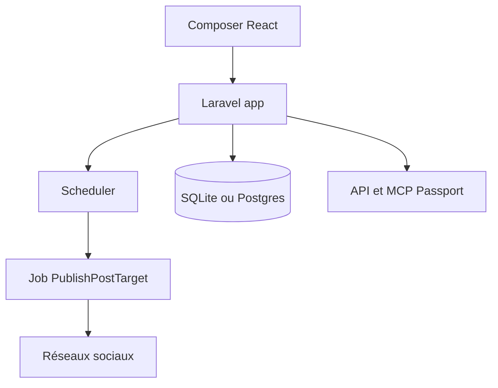

# coollabsio/shoutrrr

> Self-hosted tool for scheduling posts on X, Bluesky, LinkedIn, Facebook, Instagram, Threads and Discord.

## The problem
Tools like Buffer or Hootsuite charge per seat and hold your tokens and data.

## What it actually does
A post editor with media, thread splitting, publishing to multiple accounts with retries, a slot-based queue and a calendar. It adds engagement analytics, workspaces with roles, 2FA and passkeys, a REST API and an MCP integration. The Docker image bundles the app, the worker and the scheduler, with SQLite by default.

## How it is wired
Simplified diagram based on the sheet, no diagram supplied.



## Trying it
```bash
docker pull ghcr.io/coollabsio/shoutrrr:latest
docker run --rm --entrypoint php ghcr.io/coollabsio/shoutrrr:latest /var/www/html/artisan key:generate --show
docker run -d --name shoutrrr --env-file .env.prod -p 8080:8080 \
  -v shoutrrr-storage:/var/www/html/storage \
  -v shoutrrr-sqlite:/var/www/html/database/sqlite \
  ghcr.io/coollabsio/shoutrrr:latest
```

## Cost and gotchas
You must register a developer app with X, LinkedIn and Meta; Meta publishing outside test accounts requires an app review. X API limits depend on the subscription.

## What it is not
It is not a hosted service: you manage the server, HTTPS and backups. Repo less than six months old, release candidate version (1.0.0-rc).

## Alternatives
- Buffer, Typefully, Hootsuite: ready-to-use paid services, cited by the README.

## For you
Watch: unrelated to data/AI, useful only to publish your watch notes or posts without a subscription.
