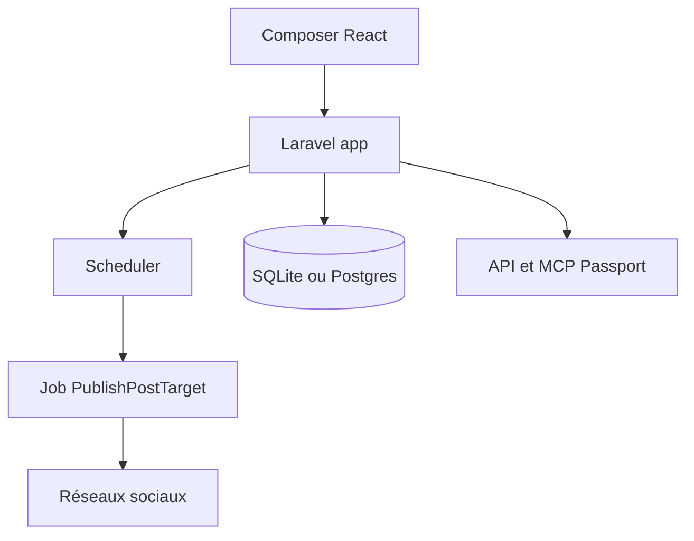

# coollabsio/shoutrrr

> Outil auto-hébergé de planification de publications sur X, Bluesky, LinkedIn, Facebook, Instagram, Threads et Discord.

## Le problème
Les outils comme Buffer ou Hootsuite se facturent par siège et détiennent tes jetons et tes données.

## Ce que ça fait vraiment
Un éditeur de posts avec médias, répartition en fils, publication sur plusieurs comptes avec reprises, file d'attente avec créneaux et calendrier. Il ajoute des analyses d'engagement, des espaces de travail avec rôles, 2FA et passkeys, une API REST et une intégration MCP. L'image Docker embarque l'application, le worker et le planificateur, avec SQLite par défaut.

## Comment c'est branché
Schéma simplifié d'après la fiche, sans diagramme fourni.



## Essayer
```bash
docker pull ghcr.io/coollabsio/shoutrrr:latest
docker run --rm --entrypoint php ghcr.io/coollabsio/shoutrrr:latest /var/www/html/artisan key:generate --show
docker run -d --name shoutrrr --env-file .env.prod -p 8080:8080 \
  -v shoutrrr-storage:/var/www/html/storage \
  -v shoutrrr-sqlite:/var/www/html/database/sqlite \
  ghcr.io/coollabsio/shoutrrr:latest
```

## Coût et pièges
Il faut enregistrer une application développeur chez X, LinkedIn et Meta ; la publication Meta hors comptes de test exige une revue d'application. Les limites de l'API X dépendent de l'abonnement.

## Ce que ce n'est pas
Ce n'est pas un service hébergé : tu gères serveur, HTTPS et sauvegardes. Dépôt de moins de six mois, version candidate (1.0.0-rc).

## Alternatives
- Buffer, Typefully, Hootsuite : services payants prêts à l'emploi, cités par le README.

## Pour toi
À surveiller : sans rapport direct avec data/IA, utile seulement pour publier ta veille ou tes billets sans abonnement.

