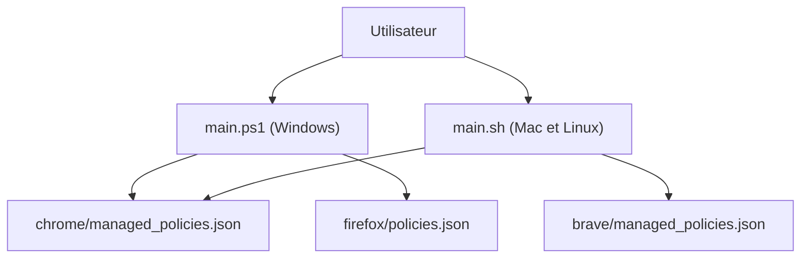

# corbindavenport/just-the-browser

> Policy files and scripts that remove AI, telemetry and sponsored content from Chrome, Edge, Firefox and Brave.

## The problem
Desktop browsers embed AI features, telemetry and sponsored content that the visible settings do not turn off.

## What it actually does
Uses the hidden settings meant for businesses: JSON files, Windows `.reg` files or macOS `.mobileconfig` profiles. An install script applies them for you, or you follow a manual guide per browser. The repository also contains the justthebrowser.com site, generated with Eleventy.

## How it is wired


## Trying it
```bash
/bin/bash -c "$(curl -fsSL https://raw.githubusercontent.com/corbindavenport/just-the-browser/main/main.sh)"
npm install
npx @11ty/eleventy --serve
```

## Cost and gotchas
Free. The script requires administrator or root rights and runs from the internet: read its content first or follow the manual guides. Browsers may display that they are "managed by an organization".

## What it is not
Not a new browser: it configures the ones you have. It does not guarantee identical policies across future versions.

## Alternatives
Not documented in the README.

## For you
Adopt: low cost and reversible, it takes back control of the AI and telemetry features of your work browser.
