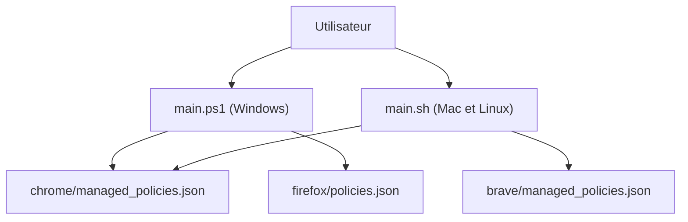

# corbindavenport/just-the-browser

> Fichiers de politiques et scripts qui retirent IA, télémétrie et contenus sponsorisés de Chrome, Edge, Firefox et Brave.

## Le problème
Les navigateurs de bureau intègrent des fonctions d'IA, de la télémétrie et des contenus sponsorisés que les réglages visibles ne coupent pas.

## Ce que ça fait vraiment
Utilise les réglages cachés prévus pour les entreprises : fichiers JSON, fichiers `.reg` Windows ou profils `.mobileconfig` macOS. Un script d'installation les pose pour toi, ou tu suis un guide manuel par navigateur. Le dépôt contient aussi le site justthebrowser.com, généré avec Eleventy.

## Comment c'est branché


## Essayer
```bash
/bin/bash -c "$(curl -fsSL https://raw.githubusercontent.com/corbindavenport/just-the-browser/main/main.sh)"
npm install
npx @11ty/eleventy --serve
```

## Coût et pièges
Gratuit. Le script exige des droits administrateur ou root et s'exécute depuis internet : lire d'abord le contenu ou suivre les guides manuels. Les navigateurs peuvent afficher qu'ils sont « gérés par une organisation ».

## Ce que ce n'est pas
Pas un nouveau navigateur : il règle ceux que tu as. Il ne garantit pas de futures politiques identiques d'une version à l'autre.

## Alternatives
Non documenté dans le README.

## Pour toi
À adopter : peu coûteux et réversible, il reprend la main sur les fonctions d'IA et de télémétrie de ton navigateur de travail.

