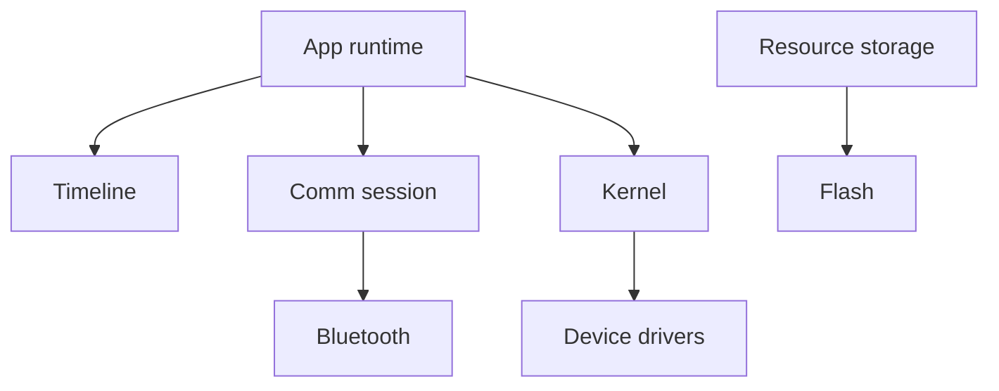

# coredevices/PebbleOS

> Open source firmware for Pebble smartwatches, relaunched by Core Devices.

## The problem
Pebble watches lost their software after the original company shut down.

## What it actually does
The README is reduced to a list of links (documentation, quickstart, code, issues). Based on the architecture, the firmware hosts applications and services: timeline, notifications, activity and health, data logging, Bluetooth, on top of a kernel and drivers, with flash storage.

## How it is wired

## Trying it
No command documented in the README, which contains only links.

## Cost and gotchas
Free code, but building firmware requires the toolchain described in the quickstart (not reproduced here). You need a compatible watch to test.

## What it is not
Not a phone app nor an app SDK: it is the watch's operating system.

## Alternatives
No alternative named in the README.

## For you
Ignore: embedded firmware unrelated to data/AI; code-reading curiosity only.
