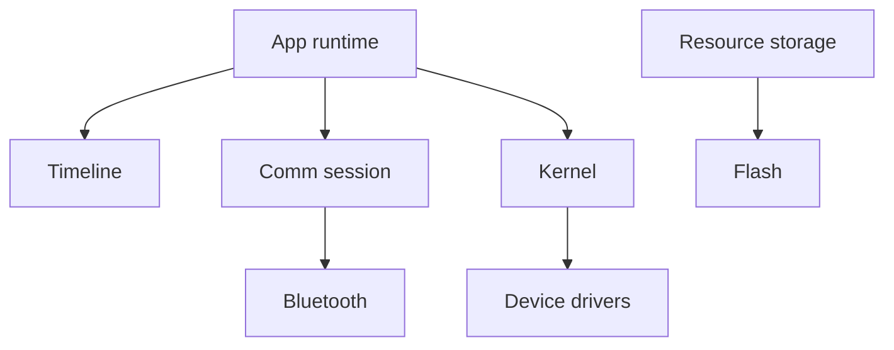

# coredevices/PebbleOS

> Firmware open source des montres connectées Pebble, relancé par Core Devices.

## Le problème
Les montres Pebble ont perdu leur logiciel après la fermeture de l'entreprise d'origine.

## Ce que ça fait vraiment
Le README est réduit à une liste de liens (documentation, quickstart, code, issues). D'après l'architecture, le firmware héberge des applications et des services : chronologie, notifications, activité et santé, journalisation de données, Bluetooth, sur un noyau et des pilotes, avec stockage en flash.

## Comment c'est branché

## Essayer
Aucune commande documentée dans le README, qui ne contient que des liens.

## Coût et pièges
Gratuit pour le code, mais compiler du firmware exige la chaîne d'outils décrite dans le quickstart (non reproduite ici). Besoin d'une montre compatible pour tester.

## Ce que ce n'est pas
Pas une application pour téléphone ni un SDK d'applications : c'est le système de la montre.

## Alternatives
Aucune alternative nommée dans le README.

## Pour toi
Ignorer : firmware embarqué sans lien avec data/IA ; curiosité de lecture de code seulement.

