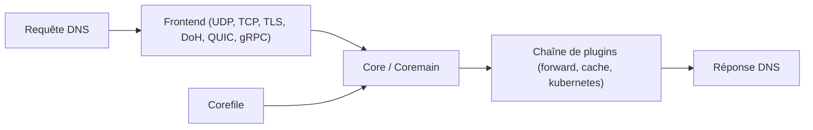

# coredns/coredns

> Plugin-chain DNS server written in Go, a CNCF project, for infrastructure and Kubernetes teams.

## The problem
Serving and relaying DNS in a configurable way (local zones, forwarding, caching, Kubernetes resolution) without a rigid monolithic server.

## What it actually does
A core receives queries (UDP/TCP, DoT, DoH, DoH3, DoQ, gRPC), reads the `Corefile` to build a plugin chain, and each plugin handles or forwards the query: `forward`, `cache`, `file`, `dnssec`, `kubernetes`, `etcd`, `prometheus`, `log`, `rewrite`, `route53`... You extend it by writing or compiling additional plugins. JSON logs available.

## How it is wired


## Trying it
```bash
git clone https://github.com/coredns/coredns
cd coredns
make
cat > Corefile <<EOF
.:53 {
    forward . 8.8.8.8
    log
}
EOF
./coredns -conf Corefile
dig @127.0.0.1 google.com
```

## Cost and gotchas
Free. Requires Go 1.26 or later to build. Port 53 is often taken (use 1053 or `-dns.port`). DoH without TLS termination requires a proxy in front. Three-version deprecation policy: a config may stop starting.

## What it is not
Not a full recursive resolver by itself: it often relays to another server. Not a data tool.

## Alternatives
The README names no other DNS solution.

## For you
Keep an eye on it: you will run into it in Kubernetes rather than deploy it on its own; worth knowing for your clusters' DNS, with no direct use for model work.
