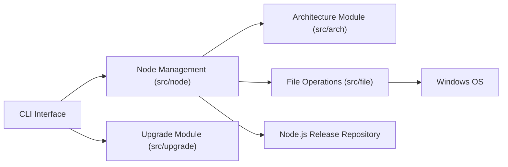

# coreybutler/nvm-windows

> Node.js version manager for Windows, rewritten as version 2, distinct from the Mac/Linux nvm.

## The problem
On Windows, switching Node.js versions between projects is laborious and often requires administrator rights.

## What it actually does
v2 offers two modes: shim (no symbolic link, written in Zig) and link (junctions, falling back to symbolic links). It pins a version per directory, installs missing versions, allows parallel installs, aliases and local downloads. Windows integrations: registry, event log, notifications. No administrator rights required.

## How it is wired

The diagram describes a Go version with symbolic links; the README speaks of a v2 rewrite (Zig): they do not match.

## Trying it
No command documented in the README (it points to the website and documentation).

## Cost and gotchas
The core is free; commercial "Certified Builds" (MSI, Intune, signing, audit logging, AD/Entra policies, SBOM) are announced as an add-on for September 2026. No license detected by the catalog.

## What it is not
Not nvm: the README states that it is a separate project, not a clone. It does not exist for Mac or Linux.

## Alternatives
- nvm (the original project, cited in the README): for Mac and Linux only.

## For you
Ignore: useful only for Node.js on Windows, and the lack of a detected license weighs against business use.
