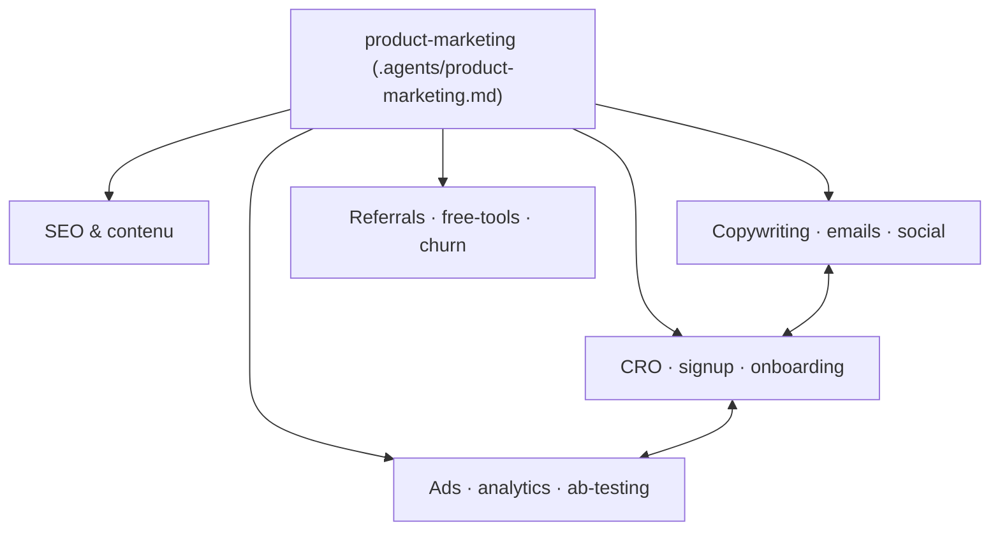

# coreyhaines31/marketingskills

> Collection of marketing skills for coding agents: Conversion Rate Optimization (CRO), copywriting, Search Engine Optimization (SEO), analytics, and growth strategies.

## The problem
An AI agent responds to a marketing task without a defined methodology: it generates plausible text, but not a page optimized for conversion.

## What it actually does
There are approximately 50 skills based on Markdown, each triggered by a specific type of request: `cro` (customer relationship optimization), `copywriting`, `seo audit`, `ai-seo`, `analytics`, `ab testing`, `emails`, `pricing`, `churn prevention`, `referrals`, `launch`, `revops`… They are interconnected and share a common context: `product marketing` is the foundation, which is read by all others first to understand the product, target audience, and positioning. Compatible with Claude Code, Codex, Cursor, Windsurf, and any agent that conforms to the Agent Skills specification.

## How it is wired


## Trying it
```bash
npx skills add coreyhaines31/marketingskills
npx skills add coreyhaines31/marketingskills -a claude-code
npx skills add coreyhaines31/marketingskills --list
```

## Cost and gotchas
Free, MIT. Installation trap detected: initiated **from** an agent session, the command-line interface operates in non-interactive mode and can only install in `.agents/skills/`, which Claude Code does not read – hence the `-a claude-code`. The migration from v1.x to v2.0 leaves behind outdated folders that need to be manually deleted.

## What it is not
This is not a tool; it is a set of Markdown files containing instructions, without any execution or data. Funding is provided through "Verified Partners" (Converly, Ploy): tools are disclosed and presented as not influencing the recommendations, but this needs to be verified independently.

## Alternatives
- SkillKit (`npx skillkit install`): An alternative multi-agent installation method.

## For you
Things to watch out for: While not directly related to your technical expertise, it's a good example of a skills library that relies on a shared context file.
