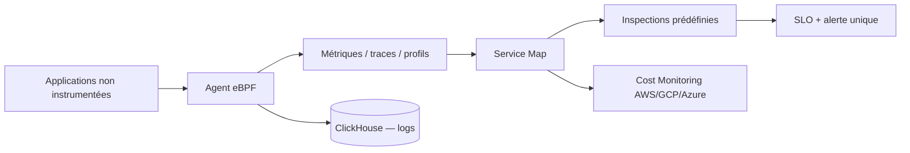

# coroot/coroot

> Zero-instrumentation observability: metrics, logs, traces and profiles collected through eBPF.

## The problem
Collecting is not observing. You pile up metrics, logs and traces, and then you still have to know
which ones to look at, and instrument legacy code you cannot recompile.

## What it actually does
Automatic collection through eBPF, so without touching application code, including legacy or
third-party software. Builds a Service Map meant to cover the whole system. Predefined inspections
audit every application with no configuration; when an SLO is missed, a single alert aggregates the
results of all relevant inspections. Automatic grouping of logs into patterns, search on ClickHouse,
CPU/memory profiling down to the line of code. Deployment tracking: each Kubernetes rollout is
compared with the previous one, cloud cost included.

## How it is wired


## Trying it
```bash
# Aucune commande documentée dans le README : il renvoie au guide d'installation
# (conteneur Docker ou déploiement Kubernetes) et à la démo demo.coroot.com.
```

## Cost and gotchas
The README details neither the license, nor the pricing, nor the split between the free and paid
editions. eBPF implies a recent kernel and elevated privileges on the nodes. ClickHouse for logs is
one more component to operate. Cost tracking is announced without access to the cloud account, so
it is based on estimates.

## What it is not
It is not a replacement for Prometheus for business metrics: it is infrastructure auto-discovery.
The "80% of problems identified automatically" claim comes from the vendor.

## Alternatives
No alternative named in the README; only OpenTelemetry is cited, as a supported standard.

## For you
Worth a look if you run uninstrumented Kubernetes; not a priority on the data science side.
