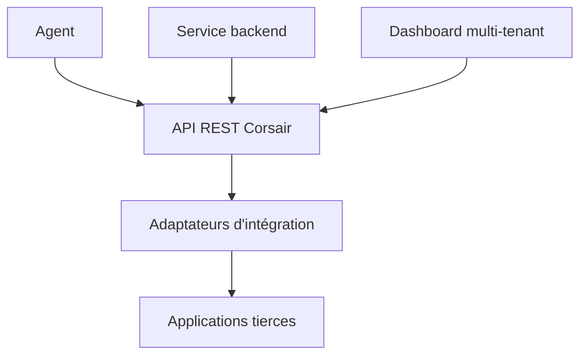

# corsairdev/corsair

> Product integration platform connecting agents and users to their third-party applications.

## The problem
The more third-party APIs an agent touches, the more glue code you have to write for each one.

## What it actually does
Corsair exposes a REST integration layer with a common syntax for all integrations, maintained by the team. It serves agents, backend services and multi-tenant dashboards. Self-hostable, or through Hub to manage OAuth and webhooks. Installation and architecture: not documented in the material provided.

## How it is wired

Diagram inferred from the README, no code diagram provided.

## Trying it
```bash
# non documenté dans le README fourni
```

## Cost and gotchas
Hub is a managed offering whose terms are not detailed. The README gives neither prerequisites nor price.

## What it is not
Not only MCP: the README distances itself from MCP-only tools. License not identified by GitHub. No command is provided.

## Alternatives
No alternative named in the README.

## For you
Worth watching: the idea of a single layer for agents is interesting, but the README allows neither trying it nor judging the license.
