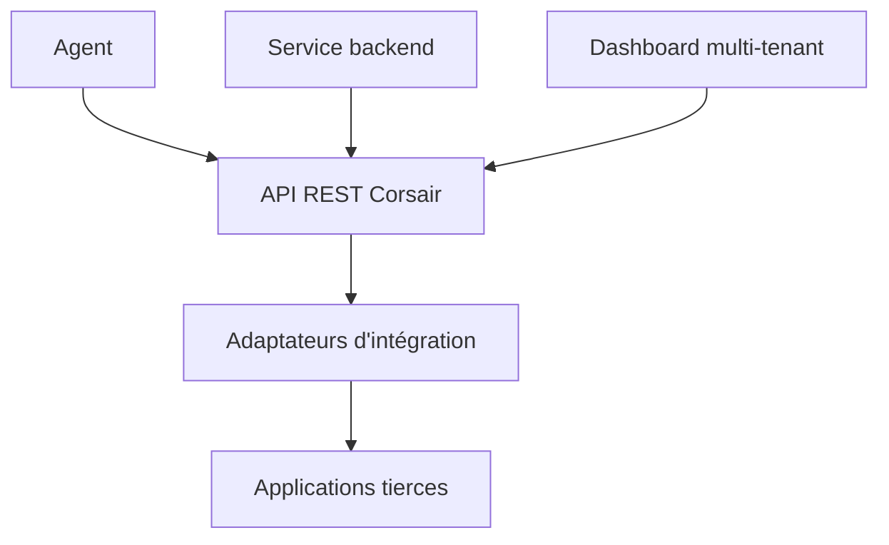

# corsairdev/corsair

> Plateforme d'intégration de produits reliant agents et utilisateurs à leurs applications tierces.

## Le problème
Plus un agent touche d'API tierces, plus il faut écrire de code de liaison propre à chacune.

## Ce que ça fait vraiment
Corsair expose une couche d'intégration REST avec une syntaxe commune pour toutes les intégrations, maintenues par l'équipe. Elle sert aux agents, services backend et tableaux de bord multi-tenants. Auto-hébergeable, ou via Hub pour gérer OAuth et webhooks. Installation et architecture : non documentées dans la matière fournie.

## Comment c'est branché

Schéma déduit du README, sans diagramme de code fourni.

## Essayer
```bash
# non documenté dans le README fourni
```

## Coût et pièges
Hub est une offre gérée dont les conditions ne sont pas détaillées. Le README ne donne ni prérequis ni prix.

## Ce que ce n'est pas
Pas uniquement du MCP : le README se démarque des outils MCP-only. Licence non identifiée par GitHub. Aucune commande n'est fournie.

## Alternatives
Aucune alternative nommée dans le README.

## Pour toi
À surveiller : l'idée d'une couche unique pour agents est intéressante, mais le README ne permet ni d'essayer ni de juger la licence.

