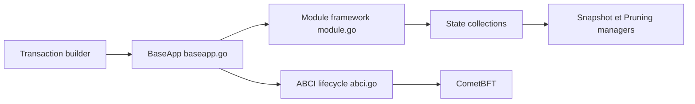

# cosmos/cosmos-sdk

> Modular Go framework for building application-specific layer 1 blockchains.

## The problem
Create your own sovereign blockchain without rewriting consensus, accounts, governance and interoperability.

## What it actually does
Provides `BaseApp`, the ABCI lifecycle, a module framework (bank, staking, governance...), message routing, state management, snapshots and pruning, and query and transaction-broadcast clients. IBC interoperability, CometBFT consensus engine recommended. The README claims more than 200 chains in production.

## How it is wired

## Trying it
No command documented in the README: it points to the tutorial and the online documentation.

## Cost and gotchas
Free. The `enterprise/` directory has different license terms from the core, not detailed in the README.

## What it is not
Not a ready-to-use chain: it is a Go construction kit. The Cosmos Hub application lives in the cosmos/gaia repository.

## Alternatives
CometBFT (consensus engine), IBC (interoperability) and Cosmos EVM (EVM layer), all cited as parts of the stack.

## For you
Ignore: blockchain tooling with no use in data/AI/MLOps work, and the "enterprise" modules have a license to check.
