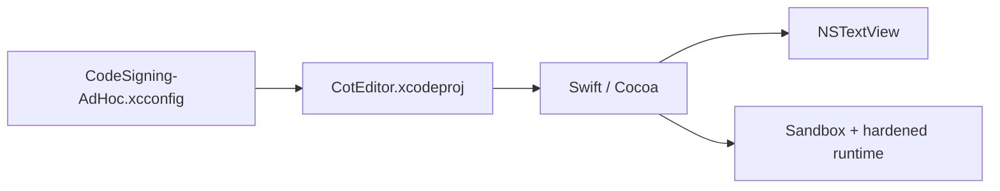

# coteditor/CotEditor

> Lightweight native plain-text editor for macOS, faithful to the system interface.

## The problem
Editing plain text on a Mac with a simple tool that respects macOS conventions.

## What it actually does
Swift application based on Cocoa's document architecture and `NSTextView`. It requires macOS Tahoe 26. Stated principles: macOS application behavior, accessible to beginners and experts alike, "less is more", faithful encoding handling and localization in 17 languages. Features foreign to the macOS style may be refused.

## How it is wired


## Trying it
No command: build via Xcode.
```bash
# 1. Ouvrir CotEditor.xcodeproj
# 2. Pour un build local : décommenter #include "CodeSigning-AdHoc.xcconfig"
#    dans Configurations/CodeSigning.xcconfig
# 3. Construire le schéma « CotEditor »
```

## Cost and gotchas
Free. macOS only. License present but not identified by GitHub: read it before any reuse.

## What it is not
Not an IDE nor an extensible code editor: deliberately minimalist.

## Alternatives
None cited in the README.

## For you
Ignore: text editing on Mac, unrelated to data/AI pipelines; you surely already have your code editor.
