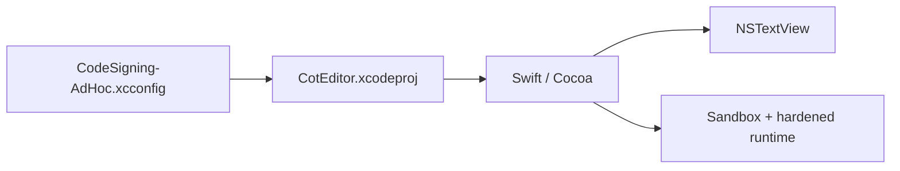

# coteditor/CotEditor

> Éditeur de texte brut léger et natif pour macOS, fidèle à l'interface du système.

## Le problème
Éditer du texte brut sur Mac avec un outil simple qui respecte les conventions macOS.

## Ce que ça fait vraiment
Application Swift fondée sur l'architecture document de Cocoa et `NSTextView`. Elle exige macOS Tahoe 26. Principes affichés : comportement d'application macOS, accessible aux débutants comme aux experts, « less is more », gestion fidèle des encodages et localisation en 17 langues. Les fonctions étrangères au style macOS peuvent être refusées.

## Comment c'est branché


## Essayer
Aucune commande : build via Xcode.
```bash
# 1. Ouvrir CotEditor.xcodeproj
# 2. Pour un build local : décommenter #include "CodeSigning-AdHoc.xcconfig"
#    dans Configurations/CodeSigning.xcconfig
# 3. Construire le schéma « CotEditor »
```

## Coût et pièges
Gratuit. macOS uniquement. Licence présente mais non identifiée par GitHub : à lire avant toute réutilisation.

## Ce que ce n'est pas
Pas un IDE ni un éditeur de code extensible : volontairement minimaliste.

## Alternatives
Aucune citée dans le README.

## Pour toi
Ignorer : édition de texte sur Mac, sans lien avec les pipelines data/IA ; tu as sûrement déjà ton éditeur de code.

