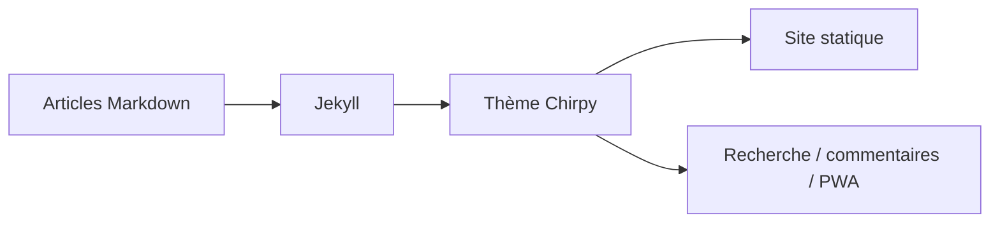

# cotes2020/jekyll-theme-chirpy

> A clean, responsive Jekyll theme for technical blogs, with dark mode, search and PWA support.

## The problem
Publishing a clean static technical blog without having to design the layout or navigation yourself.

## What it actually does
Adds to Jekyll a responsive layout, light/dark modes, pinned posts, hierarchical categories, trending tags, an automatic table of contents, syntax highlighting, formulas and Mermaid diagrams. It includes search, several comment systems, Atom feeds, PWA support, analytics and SEO. The documentation is in the wiki.

## How it is wired

## Trying it
No command is documented in the README: it points to the wiki for usage, development and upgrading.

## Cost and gotchas
Free. Requires the Ruby/Jekyll ecosystem (not detailed in the README). The comment or analytics service you choose may be paid.

## What it is not
Not a hosting platform. Not a CMS with an editing interface.

## Alternatives
None cited in the README.

## For you
Ignore: it is for running a technical blog; keep it in mind only if you want to publish your watch notes as a static site.
