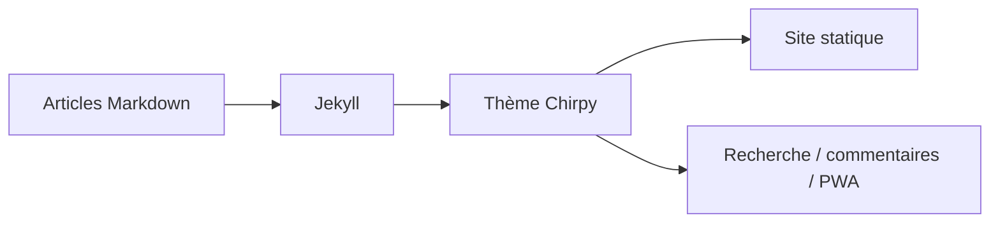

# cotes2020/jekyll-theme-chirpy

> Thème Jekyll sobre et responsive pour blogs techniques, avec mode sombre, recherche et PWA.

## Le problème
Publier un blog technique statique propre sans concevoir le design ni la navigation.

## Ce que ça fait vraiment
Ajoute à Jekyll une mise en page responsive, des modes clair/sombre, articles épinglés, catégories hiérarchiques, tags tendance, table des matières automatique, coloration syntaxique, formules et diagrammes Mermaid. Il intègre une recherche, plusieurs systèmes de commentaires, des flux Atom, le support PWA, l'analytique et le SEO. La documentation est dans le wiki.

## Comment c'est branché

## Essayer
Aucune commande documentée dans le README : il renvoie au wiki pour l'usage, le développement et la mise à niveau.

## Coût et pièges
Gratuit. Nécessite l'écosystème Ruby/Jekyll (non détaillé dans le README). Le service de commentaires ou d'analytique choisi peut être payant.

## Ce que ce n'est pas
Pas une plateforme d'hébergement. Pas un CMS avec interface d'édition.

## Alternatives
Aucune citée dans le README.

## Pour toi
Ignorer : sert à tenir un blog technique ; garde-le en tête seulement si tu veux publier tes notes de veille en site statique.

