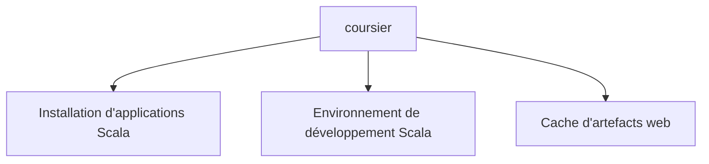

# coursier/coursier

> An application and artifact manager for Scala: installs tools and sets up the environment.

## The problem
Installing Scala applications and preparing a development environment requires downloading and caching artifacts by hand.

## What it actually does
It installs Scala applications, sets up the Scala development environment, then downloads and caches artifacts from the web. The README refers to the website for details; nothing else is documented.

## How it is wired
Simplified diagram based on the fiche, no diagram provided.

## Trying it
No command documented in the README; see the website mentioned.

## Cost and gotchas
Free. Not documented in the README beyond that. The catalog reports 424 open issues.

## What it is not
Not a general-purpose tool: it targets the Scala ecosystem. The README says no more, so the fiche remains minimal.

## Alternatives
No alternative named in the README.

## For you
Worth watching: useful only if you write Scala, for example with Spark; otherwise irrelevant for a data / AI profile.
