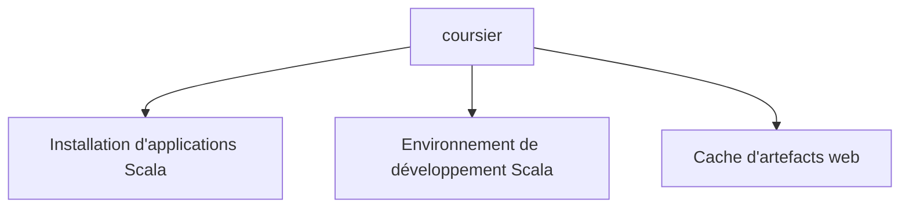

# coursier/coursier

> Gestionnaire d'applications et d'artefacts pour Scala : installe des outils et configure l'environnement.

## Le problème
Installer des applications Scala et préparer un environnement de développement demande de télécharger et mettre en cache des artefacts à la main.

## Ce que ça fait vraiment
Il installe des applications Scala, configure l'environnement de développement Scala, puis télécharge et met en cache des artefacts depuis le web. Le README renvoie au site pour le détail ; rien d'autre n'est documenté.

## Comment c'est branché
Schéma simplifié d'après la fiche, sans diagramme fourni.

## Essayer
Aucune commande documentée dans le README ; voir le site mentionné.

## Coût et pièges
Gratuit. Non documenté dans le README au-delà de cela. Le catalogue signale 424 issues ouvertes.

## Ce que ce n'est pas
Ce n'est pas un outil généraliste : il vise l'écosystème Scala. Le README n'en dit pas davantage, la fiche reste minimale.

## Alternatives
Aucune alternative nommée dans le README.

## Pour toi
À surveiller : utile seulement si tu écris du Scala, par exemple avec Spark ; sinon sans objet pour un profil data / IA.

