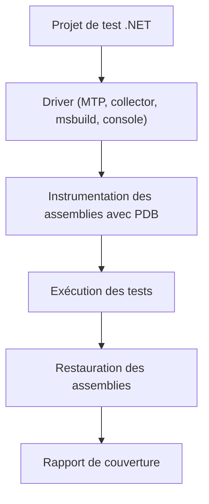

# coverlet-coverage/coverlet

> Code coverage measurement for .NET, in four integration variants, for those who test C#.

## The problem
Without measurement, you don't know which lines, branches and methods the .NET tests actually execute.

## What it actually does
Coverlet finds the test assembly and the referenced assemblies that have PDBs, inserts code into them that records hits, then restores the original files. It then writes the report (json, lcov, opencover, cobertura). Four "drivers": coverlet.MTP, coverlet.collector, coverlet.msbuild and the global tool coverlet.console.

## How it is wired
Simplified diagram based on the sheet, no diagram provided.



## Trying it
```bash
dotnet add package coverlet.collector
dotnet test --collect:"XPlat Code Coverage"
```

## Cost and gotchas
Free, .NET 8 SDK or later required. Do not mix collector and msbuild in the same test project; both are incompatible with Microsoft Testing Platform (use coverlet.MTP then).

## What it is not
Not a visualization tool: it produces report files. Only covers SDK-style .NET projects. The README describes the state of the repository, not necessarily the latest published version.

## Alternatives
Not documented in the README (it only cites complementary modules, Cake.Coverlet and Fine Code Coverage).

## For you
Adopt only if you work with .NET: it is the default coverage tool of the ecosystem, outside that scope it is of no use.
