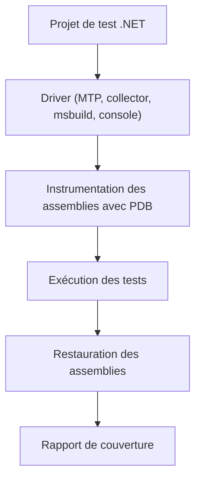

# coverlet-coverage/coverlet

> Mesure de couverture de code pour .NET, en quatre variantes d'intégration, pour qui teste du C#.

## Le problème
Sans mesure, on ne sait pas quelles lignes, branches et méthodes les tests .NET exécutent vraiment.

## Ce que ça fait vraiment
Coverlet repère l'assembly de test et les assemblies référencées qui ont des PDB, y insère du code qui enregistre les passages, puis restaure les fichiers d'origine. Il écrit ensuite le rapport (json, lcov, opencover, cobertura). Quatre « drivers » : coverlet.MTP, coverlet.collector, coverlet.msbuild et l'outil global coverlet.console.

## Comment c'est branché
Schéma simplifié d'après la fiche, sans diagramme fourni.



## Essayer
```bash
dotnet add package coverlet.collector
dotnet test --collect:"XPlat Code Coverage"
```

## Coût et pièges
Gratuit, SDK .NET 8 ou plus requis. Ne pas mélanger collector et msbuild dans un même projet de test ; ces deux-là sont incompatibles avec Microsoft Testing Platform (il faut alors coverlet.MTP).

## Ce que ce n'est pas
Pas un outil de visualisation : il produit des fichiers de rapport. Ne couvre que les projets .NET de style SDK. Le README décrit l'état du dépôt, pas forcément la dernière version publiée.

## Alternatives
Non documenté dans le README (il cite seulement des modules complémentaires, Cake.Coverlet et Fine Code Coverage).

## Pour toi
Adopter seulement si tu touches à du .NET : c'est l'outil de couverture par défaut de l'écosystème, hors de ce périmètre il ne sert à rien.

