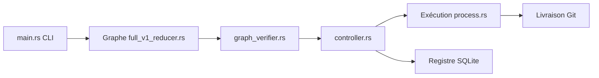

# covibes/zeroshot

> A multi-agent graph runner where one agent codes, others review, and delivery waits for the checks.

## The problem
The agent that writes the code decides on its own that it works; the orchestration loop hidden in the prompts is hard to inspect.

## What it actually does
A native executable (Rust) runs an explicit graph: a worker implements, acceptance and code review run in parallel, rejections go to bounded repair, then delivery happens (branch, PR or merge). Every event is written to a durable SQLite ledger. Three targets: local (reuses Codex or Claude Code logins), self-hosted Docker container and Zeroshot cloud. Web interface for profiles and history, Python client, experimental ACP mode.

## How it is wired


## Trying it
```bash
npm install -g @the-open-engine-company/zeroshot
zeroshot template list
zeroshot template show software-change
zeroshot ui
```

## Cost and gotchas
Codex or Claude subscription or API key at your own expense; the cloud target requires an account. Version 8 is announced as an interface break (Node.js runtime removed).

## What it is not
Not a guarantee of correctness: reviews are done by other agents. The ACP mode is marked experimental. The cloud and delivery targets were not examined in detail.

## Alternatives
No alternative named in the README.

## For you
Worth watching: the idea of an auditable control graph with independent review is interesting for coding agents, but the repository is under nine months old and remains unstable.
