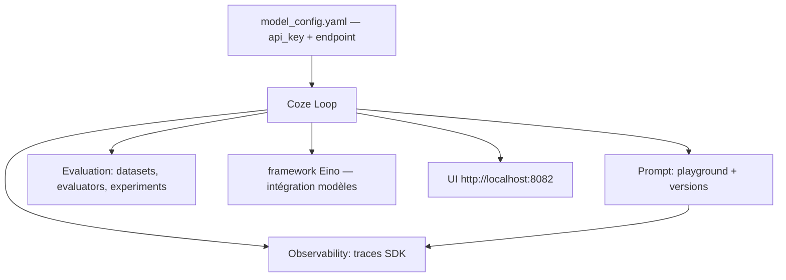

# coze-dev/coze-loop

> Self-hostable development, evaluation and observability platform for AI agents.

## The problem
An agent is developed in a notebook, evaluated by eye and not monitored at all.
Prompts have no versions, outputs have no metrics, calls have no traces.

## What it actually does
A prompt module with a visual Playground: writing, debugging, comparing outputs across LLMs, versioning.
An evaluation module: managed evaluation sets, evaluators, experiments, automated multi-dimensional tests (accuracy, conciseness, compliance).
An observability module that records every execution step — prompt parsing, model call, tool execution — with intermediate results and exceptions.
The SDK exists in three languages, shared between the commercial and open source editions, with only initialization parameters to change.

## How it is wired


## Trying it
```bash
git clone https://github.com/coze-dev/coze-loop.git
cd coze-loop
# éditer release/deployment/docker-compose/conf/model_config.yaml (api_key, model)
make compose-up
# ou en Kubernetes :
helm pull oci://docker.io/cozedev/coze-loop --version 1.0.0-helm
make helm-up
```

## Cost and gotchas
The open source edition is free but requires a Volcengine Ark (or BytePlus ModelArk) key and its Endpoint ID in `model_config.yaml`.
The README explicitly warns against deploying on a public network: open registration, listening address, SSRF and horizontal privilege escalation in some APIs.

## What it is not
It is not the complete platform: it is the open source edition of "foundational" modules of a commercial product, with ByteDance keeping the rest.
It is not ready for exposure either: the default mode is development mode, with backend file modification without redeployment.

## Alternatives
- Eino framework (CloudWeGo team): cited as the model integration layer, usable on its own.

## For you
The prompt/eval/traces triptych is the right split; weigh the dependency on Volcengine Ark before putting your experiments in it.
