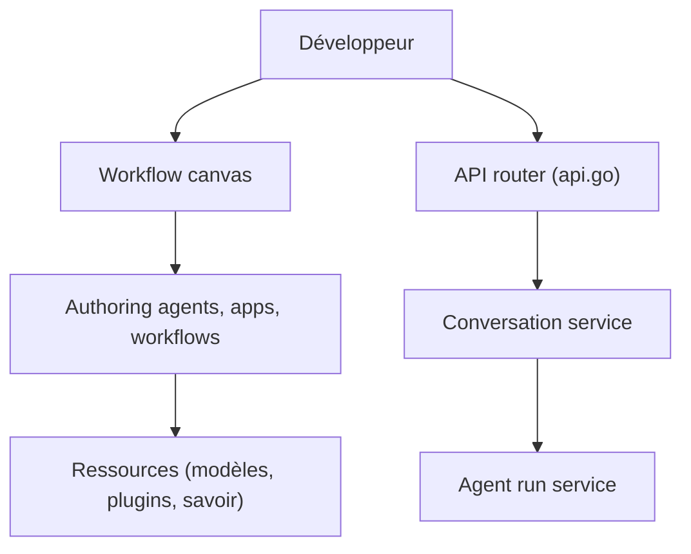

# coze-dev/coze-studio

> Visual low-code platform to build, debug and deploy AI agents, apps and workflows, self-hosted.

## The problem
Building agents with prompts, RAG, plugins and workflows requires a lot of assembly.

## What it actually does
Visual workflow editor, management of agents, apps and resources (plugins, knowledge bases, databases, prompts), conversation API and chat SDK. Go backend in DDD, React/TypeScript frontend. Models to configure (OpenAI, Volcengine). Some features are reserved for the commercial version.

## How it is wired


## Trying it
```bash
git clone https://github.com/coze-dev/coze-studio.git
cd coze-studio
make web
# Windows :
cp ./docker/.env.example ./docker/.env
docker compose -f ./docker/docker-compose.yml up
```

## Cost and gotchas
2 cores, 4 GB minimum, Docker. You must create a local account then configure a model (key at your expense). Security warning: sign-up, Python execution of workflows, SSRF when publicly exposed.

## What it is not
Not the full equivalent of the commercial version. Last push in July 2026: slower pace than others.

## Alternatives
No alternative named in the README.

## For you
Keep an eye on it: useful for prototyping agents without code locally, not to be exposed without hardening.
