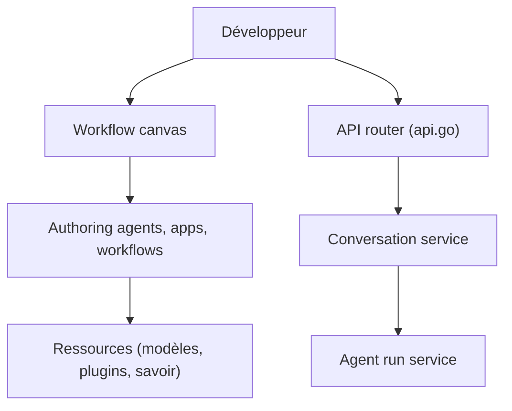

# coze-dev/coze-studio

> Plateforme visuelle low-code pour créer, déboguer et déployer agents IA, apps et workflows, auto-hébergée.

## Le problème
Construire des agents avec prompts, RAG, plugins et workflows exige beaucoup d'assemblage.

## Ce que ça fait vraiment
Éditeur visuel de workflows, gestion d'agents, d'apps et de ressources (plugins, bases de connaissances, bases de données, prompts), API de conversation et SDK de chat. Backend Go en DDD, frontend React/TypeScript. Modèles à configurer (OpenAI, Volcengine). Certaines fonctions sont réservées à la version commerciale.

## Comment c'est branché


## Essayer
```bash
git clone https://github.com/coze-dev/coze-studio.git
cd coze-studio
make web
# Windows :
cp ./docker/.env.example ./docker/.env
docker compose -f ./docker/docker-compose.yml up
```

## Coût et pièges
2 cœurs, 4 Go minimum, Docker. Il faut créer un compte local puis configurer un modèle (clé à ta charge). Avertissement sécurité : inscription, exécution Python des workflows, SSRF en exposition publique.

## Ce que ce n'est pas
Pas l'équivalent complet de la version commerciale. Dernier push en juillet 2026 : rythme plus lent que d'autres.

## Alternatives
Aucune alternative nommée dans le README.

## Pour toi
Surveiller : utile pour prototyper des agents sans code en local, à ne pas exposer sans durcissement.

