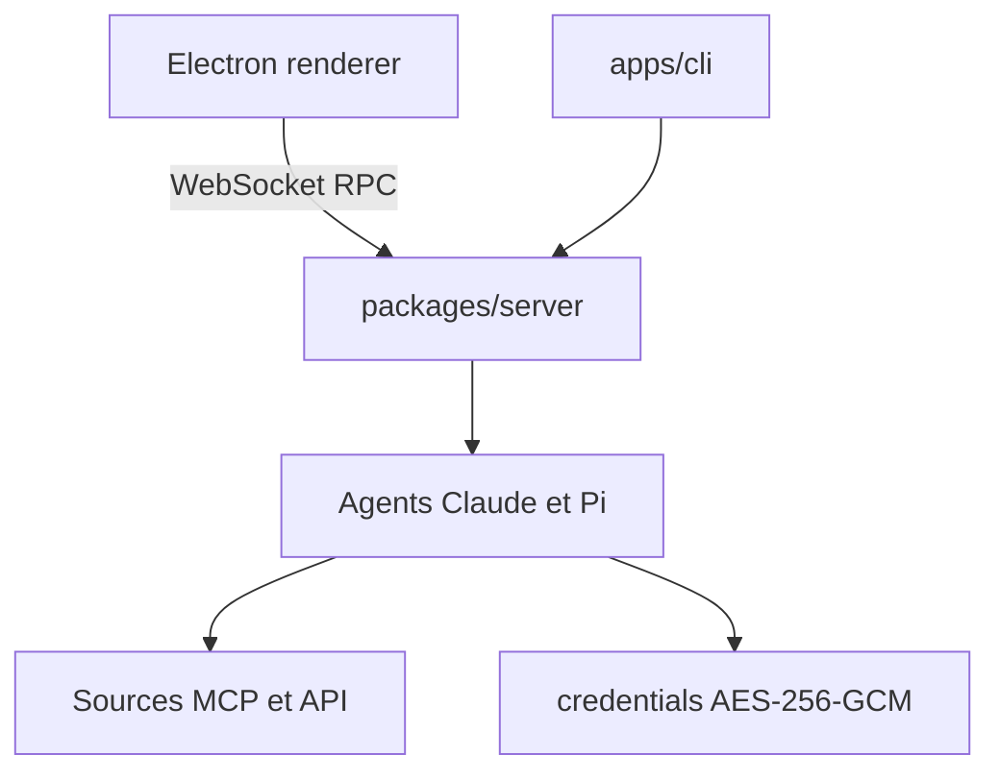

# craft-ai-agents/craft-agents-oss

> Desktop application for driving AI agents: sessions, MCP and API sources, skills, automations.

## The problem
Command-line agents handle multitasking, session sharing and connecting to services poorly.

## What it actually does
Electron application with a session inbox, two engines (Claude Agent SDK and Pi SDK), MCP, REST and local-file sources, three permission modes (explore, ask, auto), per-workspace skills and automations (cron, events). Headless server mode with a CLI client. Credentials encrypted with AES-256-GCM.

## How it is wired


## Trying it
```bash
curl -fsSL https://thecraftagents.com/install-app.sh | bash
git clone https://github.com/craft-ai-agents/craft-agents-oss.git
cd craft-agents-oss
bun install
bun run electron:start
```

## Cost and gotchas
API key or subscription from the chosen provider. Google OAuth: create your own credentials. The `allow-all` mode approves everything automatically.

## What it is not
Not an agent framework: it is a finished application. The "Craft" brand is protected. Read the install script before running it.

## Alternatives
No alternative named in the README.

## For you
Worth watching: a good interface for orchestrating agents and MCP sources, but 552 open issues and a dependency on the Craft ecosystem.
