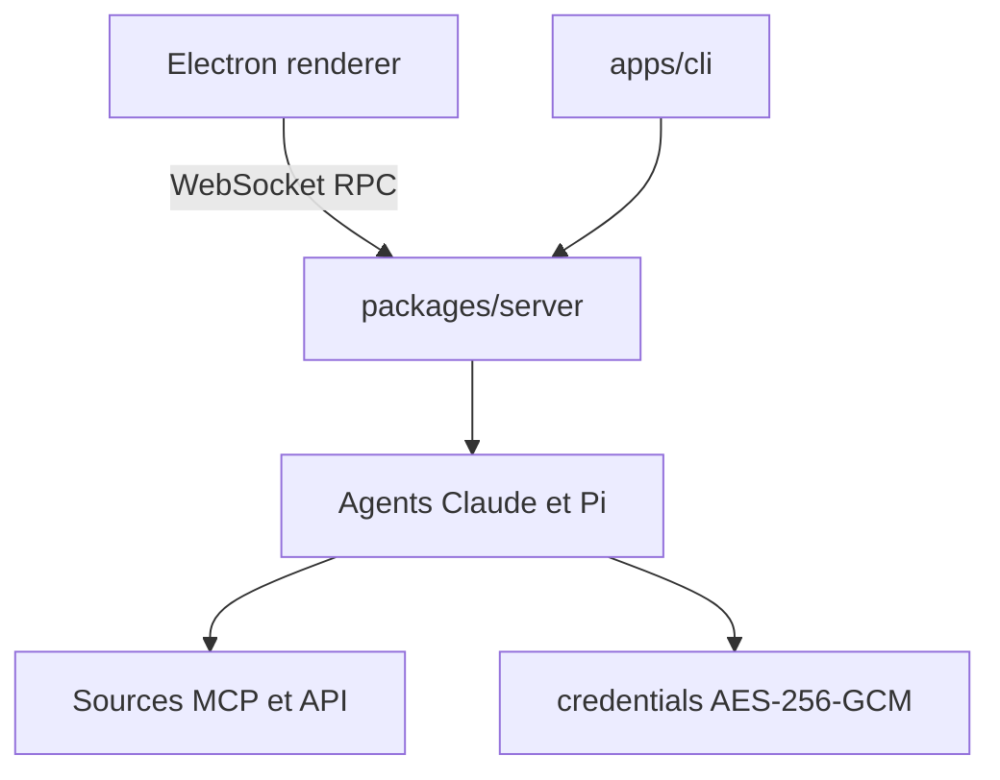

# craft-ai-agents/craft-agents-oss

> Application de bureau pour piloter des agents IA : sessions, sources MCP et API, skills, automatisations.

## Le problème
Les agents en ligne de commande gèrent mal le multitâche, le partage de sessions et la connexion à des services.

## Ce que ça fait vraiment
Application Electron avec boîte de réception de sessions, deux moteurs (Claude Agent SDK et Pi SDK), sources MCP, REST et fichiers locaux, trois modes de permission (explorer, demander, auto), skills par espace de travail et automatisations (cron, événements). Mode serveur sans écran avec client CLI. Identifiants chiffrés en AES-256-GCM.

## Comment c'est branché


## Essayer
```bash
curl -fsSL https://thecraftagents.com/install-app.sh | bash
git clone https://github.com/craft-ai-agents/craft-agents-oss.git
cd craft-agents-oss
bun install
bun run electron:start
```

## Coût et pièges
Clé d'API ou abonnement du fournisseur choisi. Google OAuth : créer ses propres identifiants. Le mode `allow-all` approuve tout automatiquement.

## Ce que ce n'est pas
Pas un framework d'agents : c'est une application finie. Marque « Craft » protégée. Le script d'installation est à lire avant d'être exécuté.

## Alternatives
Aucune alternative nommée dans le README.

## Pour toi
À surveiller : bonne interface pour orchestrer agents et sources MCP, mais 552 issues ouvertes et dépendance à l'écosystème Craft.

