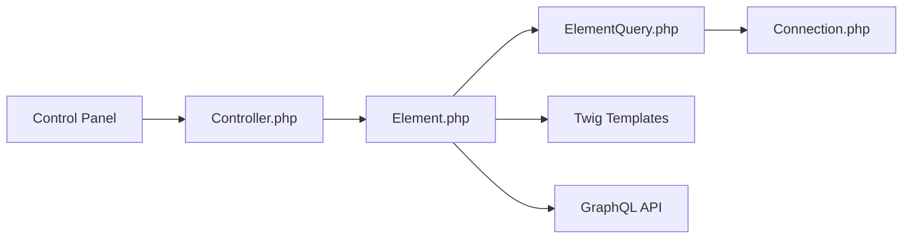

# craftcms/cms

> Self-hosted PHP CMS with free-form content modeling, for agencies and web developers.

## The problem
CMSs impose their own content structure; building a custom site forces you to work around the tool.

## What it actually does
Admin panel, modelable content elements (fields, `FieldLayout`), element queries on a MySQL or PostgreSQL database, Twig rendering, generated GraphQL API, plugins and console administration. TOTP authentication and SSO present in the code.

## How it is wired


## Trying it
```bash
# non documenté dans le README : installation via Composer (voir la documentation en ligne)
```

## Cost and gotchas
PHP server + database. Paid plugins in the store. License flagged as unidentified by GitHub.

## What it is not
Not a data/AI tool nor a ready-made site: a development foundation.

## Alternatives
- None cited in the README.

## For you
Ignore: web content management with no use for a data/AI/MLOps profile.
