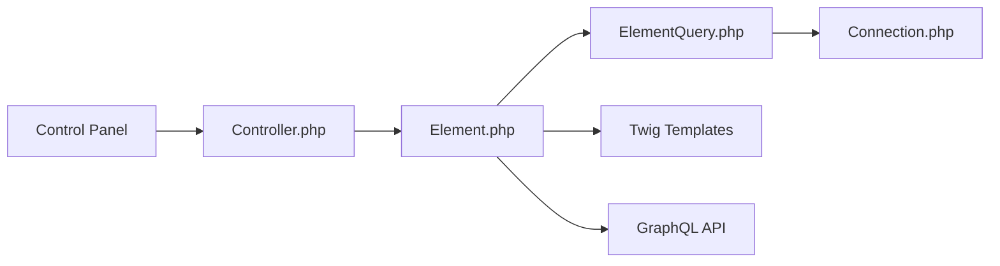

# craftcms/cms

> CMS PHP auto-hébergé à modélisation libre du contenu, pour agences et développeurs web.

## Le problème
Les CMS imposent leur structure de contenu ; construire un site sur mesure oblige à contourner l'outil.

## Ce que ça fait vraiment
Panneau d'administration, éléments de contenu modélisables (champs, `FieldLayout`), requêtes d'éléments en base MySQL ou PostgreSQL, rendu Twig, API GraphQL générée, plugins et administration en console. Authentification TOTP et SSO présents dans le code.

## Comment c'est branché


## Essayer
```bash
# non documenté dans le README : installation via Composer (voir la documentation en ligne)
```

## Coût et pièges
Serveur PHP + base de données. Plugins payants dans la boutique. Licence signalée comme non identifiée par GitHub.

## Ce que ce n'est pas
Pas un outil data/IA ni un site prêt à l'emploi : un socle de développement.

## Alternatives
- Aucune citée dans le README.

## Pour toi
À ignorer : gestion de contenu web sans usage pour un profil data/IA/MLOps.

