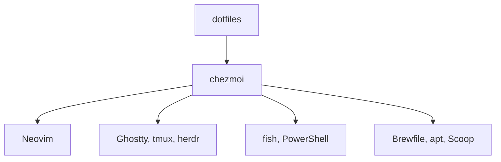

# craftzdog/dotfiles

> Takuya's personal configuration files (Neovim, tmux, Ghostty, fish, PowerShell), managed with chezmoi.

## The problem
Rebuilding an identical development setup from one machine to another takes time without versioned configuration.

## What it actually does
A dotfiles repository managed with chezmoi: Neovim config (0.12 minimum, plugins via `vim.pack`), herdr (a terminal manager for AI agents), tmux, Ghostty, git and lazygit, fish, PowerShell, and package lists for Homebrew, apt, Scoop and winget. Its README is identical to that of dotfiles-public.

## How it is wired
Simplified diagram based on the sheet, no diagram provided.

## Trying it
No command documented in the README: it lists the contents and prerequisites, and points to videos.

## Cost and gotchas
Free. No license declared. Same warning from the author: at your own risk. Neovim 0.12 and a C compiler are required on the Neovim side.

## What it is not
Not a ready-to-use tool or distribution: a personal configuration, to be read rather than applied as is. Same content as craftzdog/dotfiles-public (same stars, same dates).

## Alternatives
No alternative named in the README.

## For you
Ignore as a tool: inspiration for your terminal, with no license, and an apparent duplicate of dotfiles-public.
