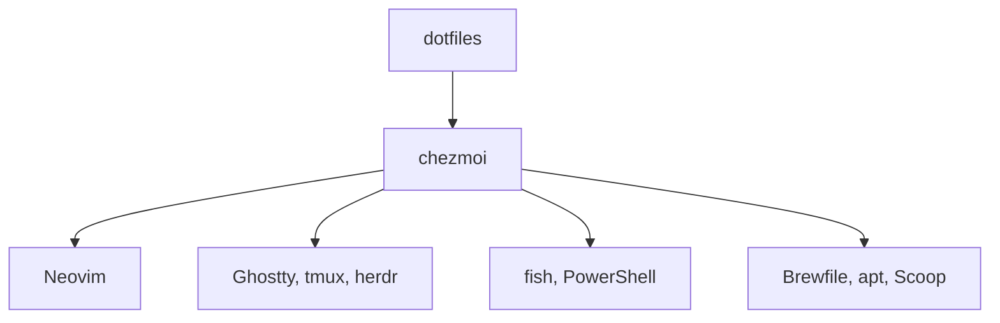

# craftzdog/dotfiles

> Fichiers de configuration personnels de Takuya (Neovim, tmux, Ghostty, fish, PowerShell), gérés avec chezmoi.

## Le problème
Reconstruire un poste de développement identique d'une machine à l'autre prend du temps sans configuration versionnée.

## Ce que ça fait vraiment
Dépôt de dotfiles géré avec chezmoi : config Neovim (0.12 minimum, plugins via `vim.pack`), herdr (gestionnaire de terminal pour agents IA), tmux, Ghostty, git et lazygit, fish, PowerShell, et listes de paquets Homebrew, apt, Scoop et winget. Son README est identique à celui de dotfiles-public.

## Comment c'est branché
Schéma simplifié d'après la fiche, sans diagramme fourni.

## Essayer
Aucune commande documentée dans le README : il liste le contenu et les prérequis, et renvoie à des vidéos.

## Coût et pièges
Gratuit. Pas de licence déclarée. Même avertissement de l'auteur : à tes risques. Neovim 0.12 et un compilateur C sont requis côté Neovim.

## Ce que ce n'est pas
Pas un outil ni une distribution prête à l'emploi : configuration personnelle, à lire plutôt qu'à appliquer telle quelle. Même contenu que craftzdog/dotfiles-public (mêmes étoiles, mêmes dates).

## Alternatives
Aucune alternative nommée dans le README.

## Pour toi
À ignorer comme outil : inspiration pour ton terminal, sans licence, et doublon apparent de dotfiles-public.

