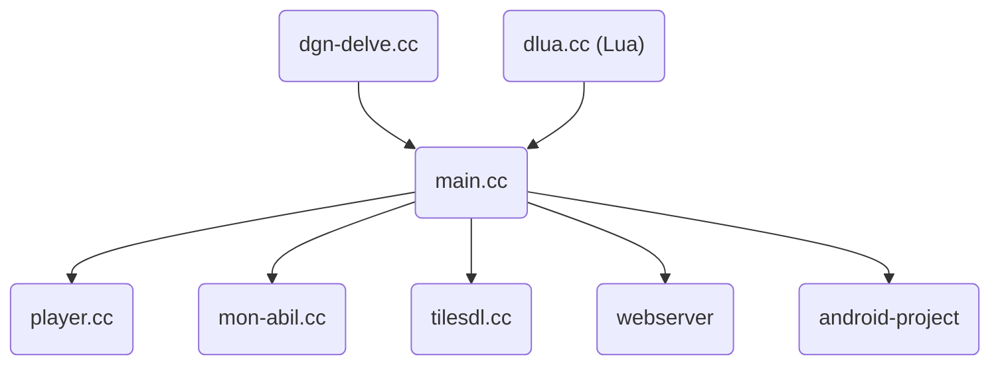

# crawl/crawl

> Dungeon Crawl Stone Soup, a roguelike dungeon-exploration role-playing game, playable in ASCII, in tiles or online.

## The problem
A deep, free and actively maintained tactical roguelike, playable offline as well as in a browser or over SSH.

## What it actually does
Turn-based game: exploration of levels made of hand-written maps (vaults), combat, magic, gods. The C++ code separates the engine, dungeon generation, monster and item systems, and several interfaces (terminal, SDL tiles, Webtiles, Android). Data and generation go through definition files and Lua.

## How it is wired

## Trying it
No command documented in the README: download the ASCII or tiles version, or play online; the built-in FAQ opens with `?Q` in the game.

## Cost and gotchas
Free. License present but not identified by GitHub. 470 open issues. Vault contributions can be tested without compiling.

## What it is not
Not an easy or story-driven game: the difficulty is high. Not a work tool.

## Alternatives
No alternative cited in the README.

## For you
Ignore: a game, unrelated to your field; only the procedural generation engine might interest a curious person.
