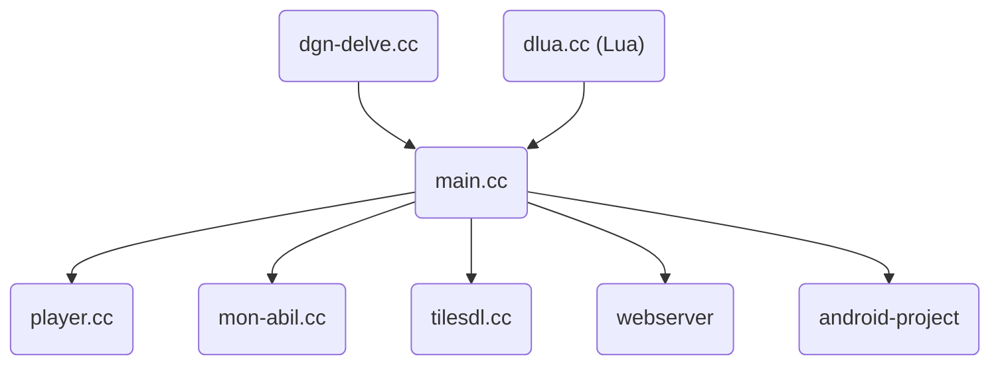

# crawl/crawl

> Dungeon Crawl Stone Soup, jeu de rôle roguelike d'exploration de donjons, jouable en ASCII, en tuiles ou en ligne.

## Le problème
Un roguelike tactique profond, libre et activement maintenu, jouable hors ligne comme en navigateur ou en SSH.

## Ce que ça fait vraiment
Jeu au tour par tour : exploration de niveaux composés de cartes écrites à la main (vaults), combat, magie, dieux. Le code C++ sépare le moteur, la génération de donjons, les systèmes de monstres et d'objets, et plusieurs interfaces (terminal, tuiles SDL, Webtiles, Android). Les données et la génération passent par des fichiers de définition et du Lua.

## Comment c'est branché

## Essayer
Aucune commande documentée dans le README : télécharger la version ASCII ou tuiles, ou jouer en ligne ; la FAQ intégrée s'ouvre avec `?Q` dans le jeu.

## Coût et pièges
Gratuit. Licence présente mais non identifiée par GitHub. 470 issues ouvertes. Les contributions de vaults se testent sans compiler.

## Ce que ce n'est pas
Pas un jeu facile ni scénarisé : la difficulté est élevée. Pas un outil de travail.

## Alternatives
Aucune alternative citée dans le README.

## Pour toi
Ignorer : un jeu, sans lien avec ton métier ; seul le moteur de génération procédurale pourrait intéresser un curieux.

