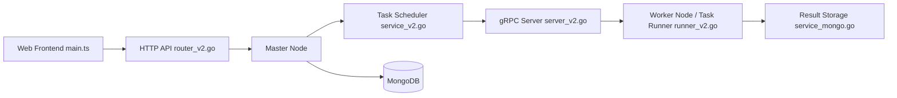

# crawlab-team/crawlab

> Web platform to schedule and supervise distributed crawlers, whatever their language or framework.

## The problem
Scattered spiders (Scrapy, Puppeteer, home-made scripts) with no common place to deploy and schedule them or track logs and results.

## What it actually does
A master node (API, scheduler, spider deployment) distributes tasks to workers via gRPC. Workers launch the crawlers as shell processes, with the task ID as an environment variable. MongoDB stores state and the queue, SeaweedFS syncs files and logs. A Python SDK saves the results.

## How it is wired


## Trying it
```bash
git clone https://github.com/crawlab-team/examples
cd examples/docker/basic
docker-compose up -d
```
Then open `http://localhost:8080`.

## Cost and gotchas
Free (BSD-3-Clause); requires Docker Compose, MongoDB (4.2 in the example) and SeaweedFS. 166 open issues. The README points out the lack of spider versioning.

## What it is not
Not a crawling framework: it orchestrates spiders that you write. It handles neither proxies nor protection bypassing; respecting robots.txt and the terms of the targeted sites remains your responsibility.

## Alternatives
- ScrapydWeb: rich interface, but limited to Scrapy.
- Gerapy: crawl rule configuration, Scrapy only.
- SpiderKeeper: simpler, Scrapy only.

## For you
Worth watching: relevant if you feed datasets by crawling in several languages; otherwise a simple Scrapy setup is enough and avoids MongoDB plus SeaweedFS.
