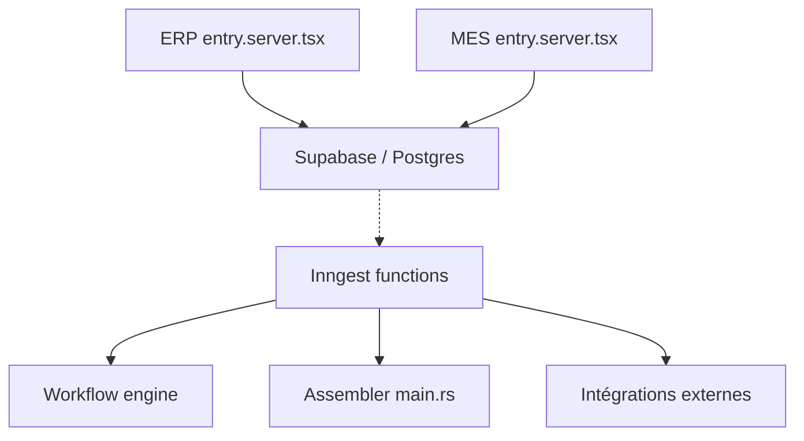

# crbnos/carbon

> Open source ERP, MRP, MES and QMS in a Postgres database, for custom manufacturing.

## The problem
Factory teams manage planning, production, quality and accounting in separate tools: bills of materials re-entered, late shortages, reconstructed costs.

## What it actually does
Two React Router applications (ERP and MES) share a Postgres/Supabase database with row-level security. They cover quotes, purchasing, inventory, versioned bills of materials, scheduling, manufacturing orders, quality, traceability and accounting. A typed API and an MCP server expose the operations, Inngest runs background jobs, a Rust service converts STEP files.

## How it is wired


## Trying it
```bash
git clone https://github.com/crbnos/carbon.git && cd carbon
corepack enable && pnpm install
cp .env.example .env
pnpm dev
```

## Cost and gotchas
Local: Docker, Node 24.22.1+ and pnpm, with no external account. Carbon Cloud is paid after a 30-day trial. The API and MCP are included in the Business and Enterprise plans, and using them self-hosted requires a commercial license.

## What it is not
Not a data or AI tool, but an industrial ERP. The README mixes open code and modules under a commercial license (`@carbon/ee`): the actual license needs checking.

## Alternatives
NetSuite, Epicor, SAP Business One, Plex, Odoo and ERPNext, cited in the README as the products it replaces.

## For you
Worth watching: interesting to see a Postgres, MCP and agents architecture applied to an ERP, but mixed license and a domain far from your core work.
