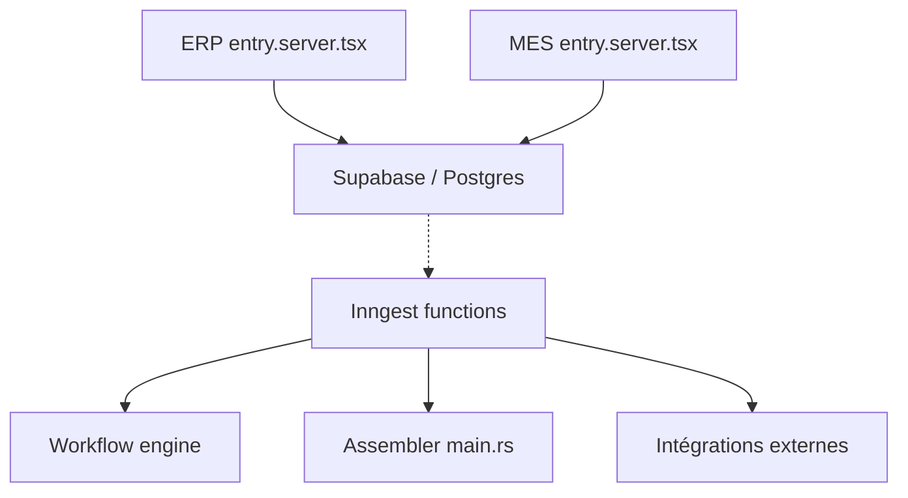

# crbnos/carbon

> ERP, MRP, MES et QMS open source dans une base Postgres, pour la fabrication sur mesure.

## Le problème
Les équipes d'usine gèrent planification, production, qualité et comptabilité dans des outils séparés : nomenclatures ressaisies, pénuries tardives, coûts reconstitués.

## Ce que ça fait vraiment
Deux applications React Router (ERP et MES) partagent une base Postgres/Supabase avec sécurité par ligne. Elles couvrent devis, achats, stocks, nomenclatures versionnées, ordonnancement, ordres de fabrication, qualité, traçabilité et comptabilité. Une API typée et un serveur MCP exposent les opérations, Inngest exécute les tâches de fond, un service Rust convertit les fichiers STEP.

## Comment c'est branché


## Essayer
```bash
git clone https://github.com/crbnos/carbon.git && cd carbon
corepack enable && pnpm install
cp .env.example .env
pnpm dev
```

## Coût et pièges
Local : Docker, Node 24.22.1+ et pnpm, sans compte externe. Carbon Cloud est payant après 30 jours d'essai. API et MCP sont inclus dans les offres Business et Enterprise, et les utiliser en auto-hébergé exige une licence commerciale.

## Ce que ce n'est pas
Ce n'est pas un outil data ou IA, mais un ERP industriel. Le README mêle code ouvert et modules sous licence commerciale (`@carbon/ee`) : la licence réelle est à vérifier.

## Alternatives
NetSuite, Epicor, SAP Business One, Plex, Odoo et ERPNext, cités dans le README comme les produits qu'il remplace.

## Pour toi
À surveiller : intéressant pour voir une architecture Postgres, MCP et agents appliquée à un ERP, mais licence mixte et domaine éloigné de ton cœur de métier.

