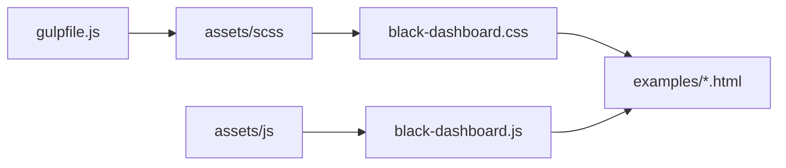

# creativetimofficial/black-dashboard

> Bootstrap web dashboard template in dark theme, for front-end developers.

## The problem
Starting an admin interface means designing pages, tables, charts and notifications before having any functionality.

## What it actually does
An HTML, CSS and JavaScript template with example pages (dashboard, profile, tables, maps, notifications, icons, typography, RTL version), SCSS, Chart.js and a gulpfile. The documentation is hosted on the publisher's site.

## How it is wired


## Trying it
```bash
npm i black-dashboard
git clone https://github.com/creativetimofficial/black-dashboard.git
```

## Cost and gotchas
Free under the MIT license, but the last push dates from July 2024. The README also serves to promote other products from the publisher.

## What it is not
Not a framework: it is a static template. No backend or data connected, the demo charts are fake.

## Alternatives
No alternative named in the README.

## For you
Ignore: a generic Bootstrap template, rarely updated, while your dashboard needs go through dedicated data tools.
