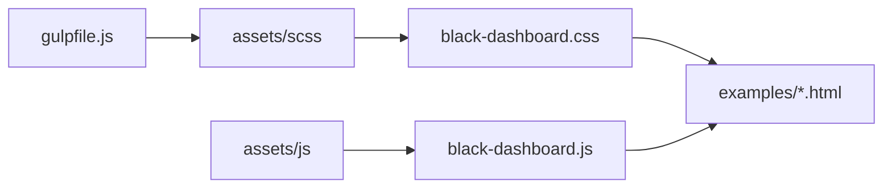

# creativetimofficial/black-dashboard

> Modèle de tableau de bord web Bootstrap en thème sombre, pour développeurs front-end.

## Le problème
Démarrer une interface d'administration demande de dessiner pages, tableaux, graphiques et notifications avant d'avoir la moindre fonction.

## Ce que ça fait vraiment
Un gabarit HTML, CSS et JavaScript avec des pages d'exemple (tableau de bord, profil, tables, cartes, notifications, icônes, typographie, version RTL), du SCSS, Chart.js et un gulpfile. La documentation est hébergée sur le site de l'éditeur.

## Comment c'est branché


## Essayer
```bash
npm i black-dashboard
git clone https://github.com/creativetimofficial/black-dashboard.git
```

## Coût et pièges
Gratuit sous licence MIT, mais le dernier push date de juillet 2024. Le README sert aussi à promouvoir d'autres produits de l'éditeur.

## Ce que ce n'est pas
Pas un framework : c'est un gabarit statique. Aucun backend ni donnée branchée, les graphiques de démonstration sont factices.

## Alternatives
Aucune alternative nommée dans le README.

## Pour toi
À ignorer : un gabarit Bootstrap générique, peu mis à jour, alors que tes besoins de tableaux de bord passent par des outils data dédiés.

