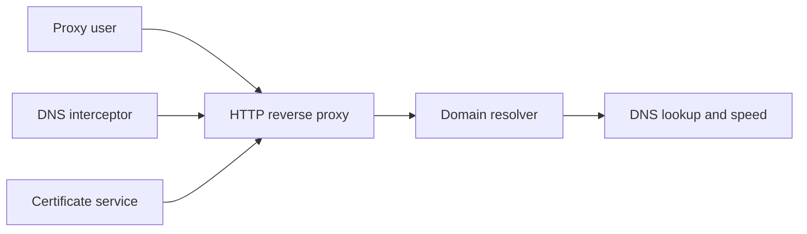

# creazyboyone/FastGithub

> Local proxy that speeds up access to GitHub (DNS, IP testing, TLS), taken over from a deleted repository.

## The problem
In some regions, GitHub is slow or unreachable: avatars, releases, clone and push fail.

## What it actually does
Local HTTP/HTTPS proxy that resolves clean IPs, tests IP speed, customizes TLS and replaces Google CDN resources. The README states that it is not a VPN. It generates one certificate authority per machine that the client must trust. Deployments: Windows, Linux, macOS, docker-compose. README in Chinese.

## How it is wired


## Trying it
```bash
sudo ./fastgithub
sudo ./fastgithub start
git config --global http.sslverify false
```

## Cost and gotchas
Free. Installing and trusting a self-generated root certificate is a risk; do not disclose the private key. Disabling git's TLS verification is not recommended.

## What it is not
Not a general circumvention tool nor a game accelerator. Takeover repository: the original is deleted and the last push dates from August 2025.

## Alternatives
The original repository dotnetcore/fastgithub, cited in the README, no longer exists.

## For you
Ignore: reserved for networks where GitHub is blocked, and it forces you to install a root certificate authority.
