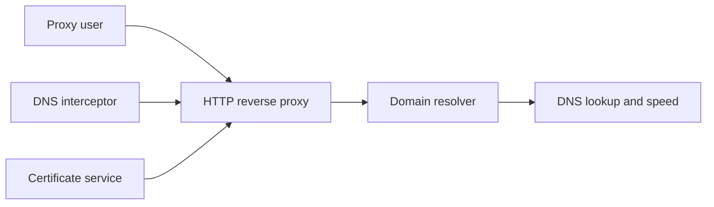

# creazyboyone/FastGithub

> Proxy local qui accélère l'accès à GitHub (DNS, test d'IP, TLS), repris d'un dépôt supprimé.

## Le problème
Dans certaines régions, GitHub est lent ou inaccessible : avatars, releases, clone et push échouent.

## Ce que ça fait vraiment
Proxy HTTP/HTTPS local qui résout des IP propres, teste la vitesse des IP, personnalise le TLS et remplace des ressources CDN de Google. Le README précise que ce n'est pas un VPN. Il génère une autorité de certification par machine que le client doit approuver. Déploiements : Windows, Linux, macOS, docker-compose. README en chinois.

## Comment c'est branché


## Essayer
```bash
sudo ./fastgithub
sudo ./fastgithub start
git config --global http.sslverify false
```

## Coût et pièges
Gratuit. Installer et faire confiance à un certificat racine auto-généré est un risque ; ne pas divulguer la clé privée. Désactiver la vérification TLS de git est déconseillé.

## Ce que ce n'est pas
Pas un outil de contournement général ni d'accélération de jeux. Dépôt de reprise : l'original est supprimé et le dernier push date d'août 2025.

## Alternatives
Le dépôt d'origine dotnetcore/fastgithub, cité dans le README, n'existe plus.

## Pour toi
À ignorer : réservé aux réseaux où GitHub est bloqué, et il t'oblige à installer une autorité de certification racine.

