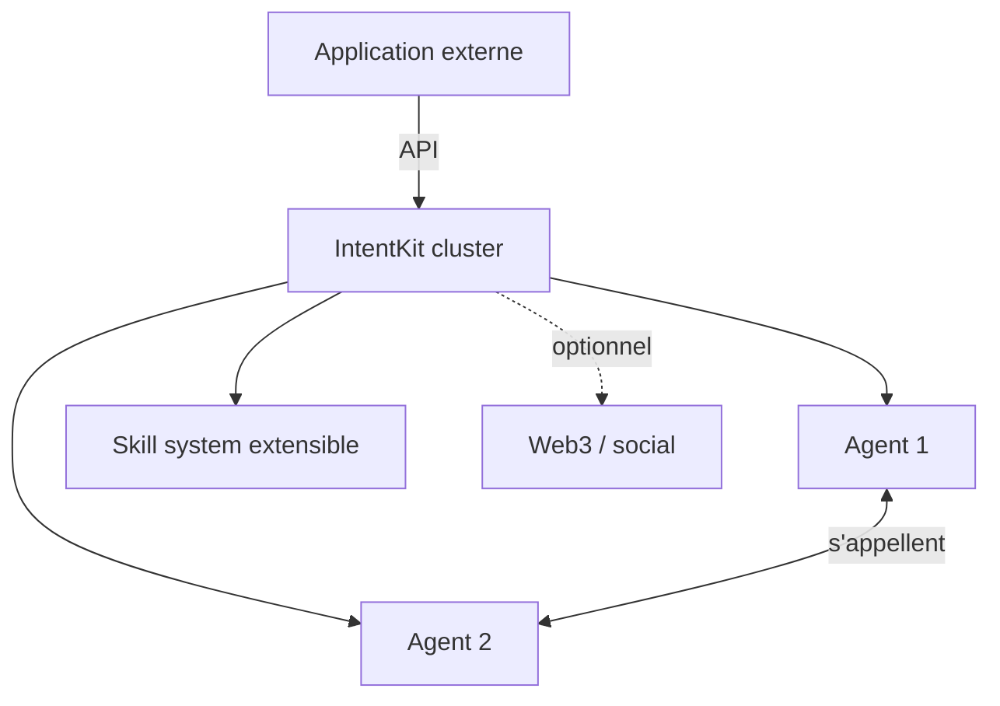

# crestalnetwork/intentkit

> Self-hosted cloud-native AI agent cluster managing a collaborative team of agents.

## The problem
Local agents require expensive hardware and broad local permissions. Getting several reliable agents to collaborate in the cloud lacks a ready-made framework.

## What it actually does
Cloud-native agent cluster: resource efficiency, agents unable to access your secret keys (secure by design), agents that call each other, ready to use, optional Web3/blockchain integrations, social networks, extensible skill system. Usable as self-deploy, as a Python library, or via API.

## How it is wired

## Trying it
No installation command in the README (it points to the Deployment Guide). Write it yourself: see the repository's deployment guide.

## Cost and gotchas
Free to host; LLM keys and third-party services (Web3, social) are at your expense. Brief README, little technical detail — insufficient material to judge real maturity.

## What it is not
Not a local assistant: cloud-oriented, minimal on local resources. Short README, promises not detailed.

## Alternatives
- OpenClaw: cited as an example of a local-first agent (opposite approach).

## For you
Worth following if you build a cloud agent team; the Web3 emphasis and the thin README call for caution.
