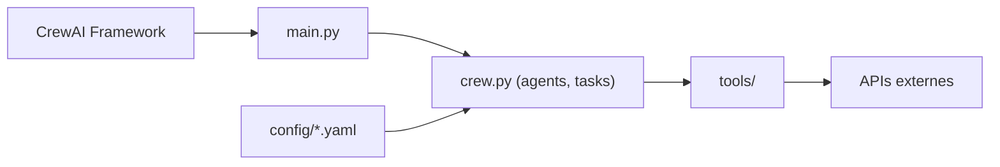

# crewAIInc/crewAI-examples

> A collection of complete applications showing how to orchestrate AI agents with CrewAI.

## The problem
Going from a multi-agent framework's documentation to a real application is hard.

## What it actually does
Standalone examples: Flows (content generator, automatic email replies, lead scoring with a human in the loop, parallel book writing) and Crews (marketing, recruiting, stock analysis, travel plan, game generator), plus LangGraph, Azure and NVIDIA integrations, and notebooks. Agents and tasks are defined in YAML; dependencies managed with UV. Written for CrewAI 0.152.0.

## How it is wired


## Trying it
```bash
git clone https://github.com/crewAIInc/crewAI-examples.git
cd crewAI-examples
cd crews/marketing_strategy
uv sync
```

## Cost and gotchas
Each example calls LLMs: keys and bill are on you. Archived repository (last push April 2026), frozen on one CrewAI version; no license declared.

## What it is not
Not production code: demos. The examples may no longer run with recent versions.

## Alternatives
- CrewAI Cookbook: guides targeted by feature.

## For you
Worth watching as a source of agent flow ideas, but archived and unlicensed: do not copy as is.
