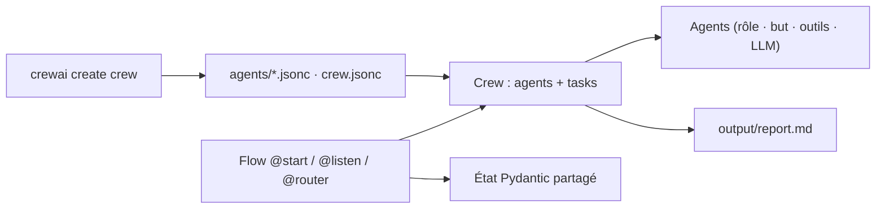

# crewAIInc/crewAI

> Python multi-agent orchestration framework, between autonomy and event-driven control.

## The problem
A single prompt is no longer enough as soon as you need multi-step work, specialized roles, tools and human review — but full autonomy makes the result unpredictable.

## What it actually does
Two complementary primitives. **Crews**: teams of agents with roles, goals and tools, who delegate to each other (sequential process or hierarchical with a manager). **Flows**: event-driven workflows with structured state (Pydantic), conditional branching via `@router`, `or_`/`and_` operators, and integration of ordinary Python code. `crewai create crew` generates a JSON-first project (`agents/*.jsonc`, `crew.jsonc`); `--classic` produces the old Python/YAML template.

## How it is wired


## Trying it
```bash
uv tool install crewai
crewai create crew latest-ai-development
crewai install
crewai run
```

## Cost and gotchas
Python ≥ 3.10 and < 3.14. By default the agents call the OpenAI API: key at your expense, plus possibly `SERPER_API_KEY` for web search. Local models possible via Ollama or LM Studio. **Anonymous telemetry enabled by default**: version, OS, number of agents and tasks, process, roles, tool names; can be disabled with `OTEL_SDK_DISABLED=true`. The `share_crew` option additionally sends descriptions, backstories, context and outputs.

## What it is not
It is not the platform: observability, governance, SSO and 24/7 support belong to the commercial AMP offering. It is not a no-code tool — everything goes through Python or JSONC.

## Alternatives
No alternative named in the README.

## For you
Worth watching: solid for prototyping a multi-agent chain, but turn off telemetry from the install in a professional context.
