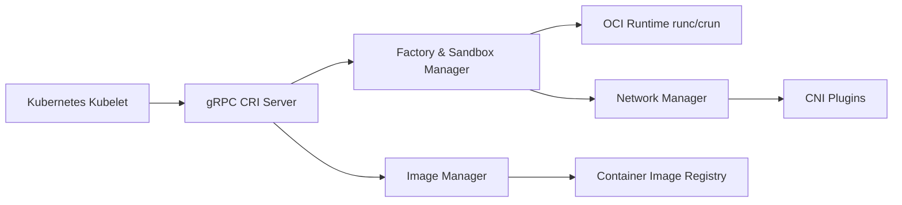

# cri-o/cri-o

> Lightweight container runtime that implements Kubernetes' CRI interface on top of OCI runtimes.

## The problem
The kubelet needs a CRI-compliant runtime; Docker or containerd bring features outside that scope.

## What it actually does
`crio` daemon exposing the CRI gRPC API to the kubelet through a unix socket.
Pulls and verifies images (containers/image), manages layers (containers/storage), launches via runc/crun.
Networking through CNI, seccomp/SELinux, OCI hooks and NRI; metrics and traces.
HTTP status API (`/info`, `/containers/:id`, `/config`) and `crio status`.

## How it is wired


## Trying it
```bash
CGROUP_DRIVER=systemd CONTAINER_RUNTIME=remote CONTAINER_RUNTIME_ENDPOINT='unix:///var/run/crio/crio.sock' ./hack/local-up-cluster.sh
sudo crio status info
```

## Cost and gotchas
Free; minor versions aligned with Kubernetes, n-2 policy. The HTTP API is not stable.

## What it is not
Not a tool for building or pushing images, nor a user CLI: use crictl or Podman.

## Alternatives
No alternative named in the README (crictl and Podman are clients).

## For you
Ignore: a Kubernetes platform team's choice, invisible to anyone deploying models on an existing cluster.
