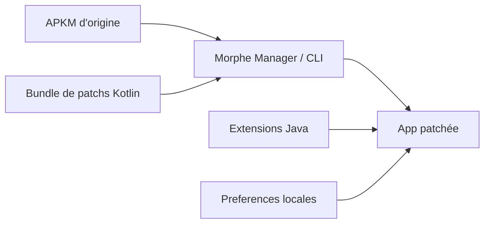

# crimera/piko

> Morphe patch bundle that modifies the Twitter/X and Instagram Android apps.

## The problem
The official apps impose their interface, their ads and their limits on sharing or downloading.

## What it actually does
A bundle of 137 Kotlin patches (75 for X, 62 for Instagram) that Morphe Manager or its CLI applies to a downloaded APKM: interface customization, ad removal, media downloads, privacy options. Java extensions are injected into the modified app. Supported versions are narrow (X 12.19.1, Instagram 447.0.0.55.81).

## How it is wired


## Trying it
```bash
java -jar cli.jar patch --patches piko.mpp input.apkm
```

## Cost and gotchas
Free. Internet connection required while patching. The patches depend on a specific app version and may break with every update.

## What it is not
Not standalone software, nor affiliated with the original publishers: some patches bypass limitations of the app, with a risk regarding its terms of use.

## Alternatives
No alternative named in the README, except X-Shim, a companion project for older versions of X.

## For you
Ignore: consumer app customization, of no value for data/AI/MLOps work.
