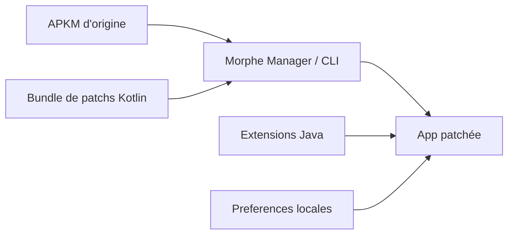

# crimera/piko

> Lot de correctifs Morphe qui modifie les applications Android Twitter/X et Instagram.

## Le problème
Les applications officielles imposent leur interface, leur publicité et leurs limites de partage ou de téléchargement.

## Ce que ça fait vraiment
Un bundle de 137 patchs Kotlin (75 pour X, 62 pour Instagram) que Morphe Manager ou sa CLI applique à un APKM téléchargé : personnalisation de l'interface, retrait de publicités, téléchargement de médias, options de confidentialité. Des extensions Java sont injectées dans l'app modifiée. Versions supportées étroites (X 12.19.1, Instagram 447.0.0.55.81).

## Comment c'est branché


## Essayer
```bash
java -jar cli.jar patch --patches piko.mpp input.apkm
```

## Coût et pièges
Gratuit. Connexion internet requise pendant le patch. Les patchs dépendent d'une version précise de l'application et peuvent casser à chaque mise à jour.

## Ce que ce n'est pas
Pas un logiciel autonome ni affilié aux éditeurs d'origine : certains patchs contournent des limitations de l'appli, avec risque vis-à-vis de ses conditions d'utilisation.

## Alternatives
Aucune alternative nommée dans le README, sauf X-Shim, projet compagnon pour les anciennes versions de X.

## Pour toi
À ignorer : personnalisation d'applications grand public, sans valeur pour un travail data/IA/MLOps.

