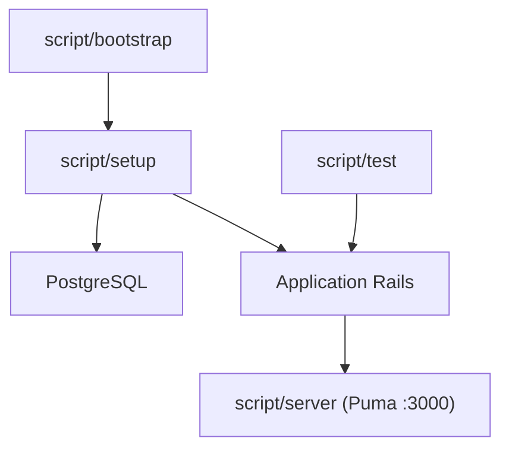

# crimethinc/website

> Ruby on Rails application that runs the crimethinc.com site, for its contributors.

## The problem
Helping develop the site requires a reproducible Rails and PostgreSQL environment.

## What it actually does
The README is mostly about installation: "Scripts to Rule Them All" (bootstrap, setup, server, update, test, console, cibuild, seed), Puma server on port 3000. It lists guides: adding a language, locales, publishing flow. The site's content is not described.

## How it is wired
Simplified diagram based on the fiche, no diagram provided.



## Trying it
```bash
./script/bootstrap
./script/setup
./script/server
./script/test
```

## Cost and gotchas
Free. Scripts designed for macOS; Windows and Linux will vary. Ruby and PostgreSQL are required, but missing from the prerequisites list.

## What it is not
Not a reusable tool: it is the code of one specific activist site.

## Alternatives
No alternative named in the README.

## For you
Ignore: editorial web application unrelated to your data / AI work.
