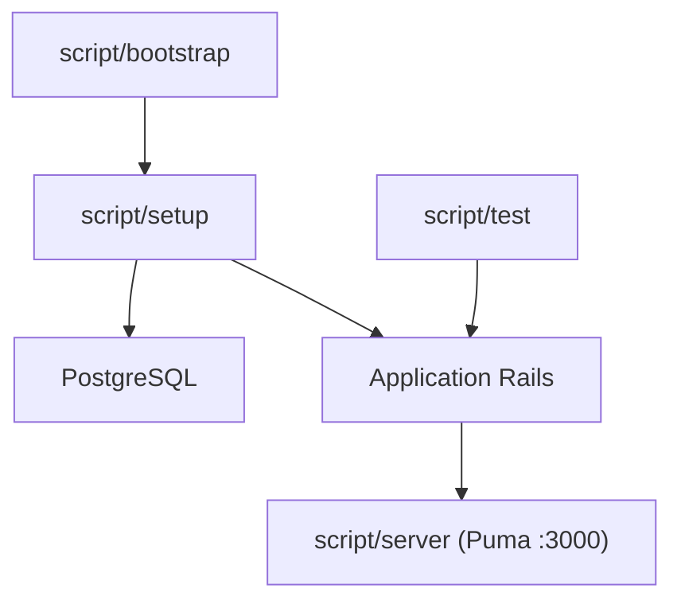

# crimethinc/website

> Application Ruby on Rails qui fait tourner le site crimethinc.com, pour ses contributeurs.

## Le problème
Aider à développer le site demande un environnement Rails et PostgreSQL reproductible.

## Ce que ça fait vraiment
Le README décrit surtout l'installation : scripts « Scripts to Rule Them All » (bootstrap, setup, server, update, test, console, cibuild, seed), serveur Puma sur le port 3000. Il liste des guides : ajout d'une langue, de locales, flux de publication. Le contenu du site n'est pas décrit.

## Comment c'est branché
Schéma simplifié d'après la fiche, sans diagramme fourni.



## Essayer
```bash
./script/bootstrap
./script/setup
./script/server
./script/test
```

## Coût et pièges
Gratuit. Scripts conçus pour macOS ; Windows et Linux varieront. Il faut Ruby et PostgreSQL, absents de la liste des prérequis.

## Ce que ce n'est pas
Pas un outil réutilisable : c'est le code d'un site militant précis.

## Alternatives
Aucune alternative nommée dans le README.

## Pour toi
Ignorer : application web éditoriale sans rapport avec ton travail data / IA.

