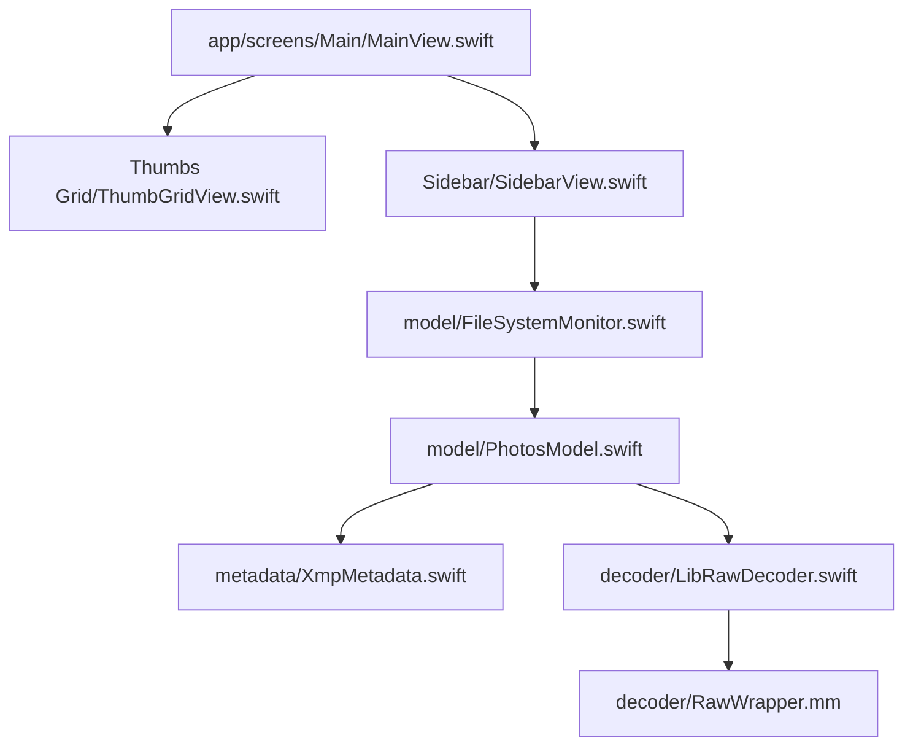

# cristibaluta/Imagin-Raw

> Native macOS app to browse, sort and rate RAW photos, a lightweight alternative to Adobe Bridge.

## The problem
Adobe Bridge is heavy (about 2 GB) and slow for sorting large series of RAW photos.

## What it actually does
Multi-folder browsing without import, real-time disk watching, ratings and labels written to XMP files, photo rejection, RAW/JPEG de-duplication, Spotlight search, SD card import, duplicate detection and export of video or client presentation PDF. RAW decoding by LibRaw through an Objective-C++ bridge.

## How it is wired


## Trying it
```bash
# Pas de commande : achat sur l'App Store, téléchargement depuis Releases, ou compilation depuis les sources.
```

## Cost and gotchas
Paid App Store version to support the project; macOS 14.6 minimum. No automatic update for the downloaded version.

## What it is not
Does not reproduce Adobe's Camera Raw previews (it shows the embedded JPEGs). The code is undergoing refactoring and code contributions are discouraged.

## Alternatives
Adobe Bridge: better for processed previews.

## For you
Ignore: macOS photography app, unrelated to data/AI work.
