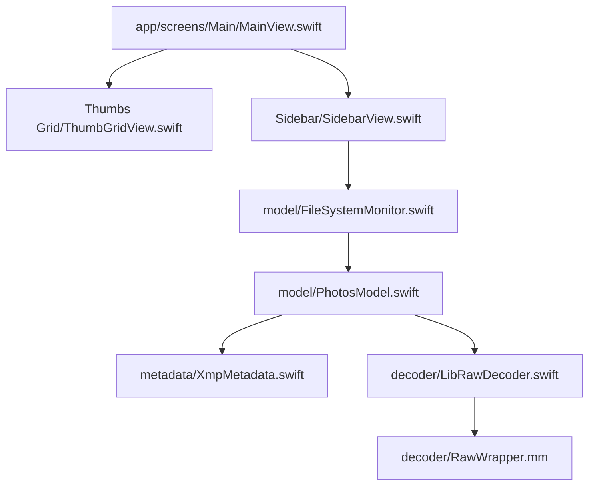

# cristibaluta/Imagin-Raw

> Application macOS native pour parcourir, trier et noter des photos RAW, alternative légère à Adobe Bridge.

## Le problème
Adobe Bridge est lourd (environ 2 Go) et lent pour trier de grandes séries de photos RAW.

## Ce que ça fait vraiment
Navigation multi-dossiers sans import, surveillance du disque en temps réel, notes et étiquettes écrites dans des fichiers XMP, rejet des photos, déduplication RAW/JPEG, recherche Spotlight, import de carte SD, détection de doublons et export de vidéo ou de PDF de présentation client. Décodage RAW par LibRaw via un pont Objective-C++.

## Comment c'est branché


## Essayer
```bash
# Pas de commande : achat sur l'App Store, téléchargement depuis Releases, ou compilation depuis les sources.
```

## Coût et pièges
Version App Store payante pour soutenir le projet ; macOS 14.6 minimum. Pas de mise à jour automatique pour la version téléchargée.

## Ce que ce n'est pas
Ne reproduit pas les aperçus Camera Raw d'Adobe (il affiche les JPEG intégrés). Le code subit des refactorings et les contributions de code sont déconseillées.

## Alternatives
Adobe Bridge : meilleur pour les aperçus retraités.

## Pour toi
À ignorer : application de photographie macOS, sans rapport avec un travail data/IA.

